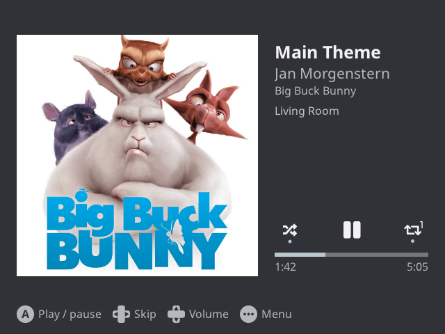
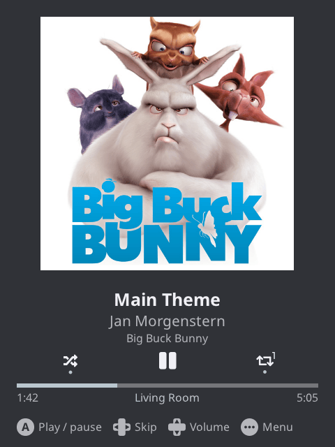
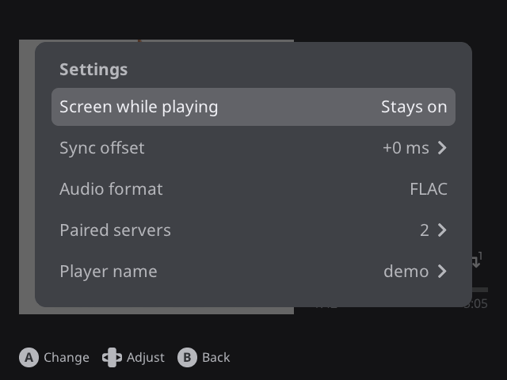

# Sendspin for muOS

A [Sendspin](https://www.sendspin-audio.com) player for [muOS](https://muos.dev) handhelds. It plays
music from [Music Assistant](https://www.music-assistant.io) or any other Sendspin server, in sync
with your other speakers, and shows what's playing with artwork and playback controls.

Built for and tested on the Anbernic RG35XX H with muOS 2606.0. The layout adapts to the screen
(landscape, square and portrait), so other muOS devices should work too.

<p>
  
  
</p>


## Install

1. Download `Sendspin.zip` from the [latest release](../../releases/latest) and unpack it into
   `MUOS/application/` on either SD card, so you get `MUOS/application/Sendspin/`.
2. Start **Sendspin** from Applications.
3. The player shows up in Music Assistant by itself. The first time a server plays to it, the player
   shows a pairing code: enter it in Music Assistant.

## Controls

| Button | Action |
| --- | --- |
| A | Play / pause |
| D-pad left / right | Previous / next |
| D-pad up / down | Group volume |
| L1 / R1 | This player's volume |
| L2 / R2 | Seek 10 s |
| X / Y | Shuffle / repeat |
| Menu | Help, Settings, Info, Quit |
| B | Back |

Touch screens work too: tap the controls, menu rows and button hints.

**Settings:** whether the screen dims while playing, the sync offset (with a graph of the clock
sync), the audio format (FLAC or Opus), the paired servers (forget one), and the player name.

## Files

On the device, everything the app keeps is in its folder, `MUOS/application/Sendspin/`:

- `state.json`: this player's key and its pairings. Delete it to start over.
- `settings.ini`: volume, sync offset, player name and the other settings.
- `Sendspin.log`: the log of the current run; `Sendspin.1.log` and `Sendspin.2.log` are the two
  before it.

## Troubleshooting

- **Sendspin doesn't appear in Applications:** on SD2, muOS picks up a newly created
  `MUOS/application` folder only after a reboot.
- **Music Assistant doesn't find the player:** the device and the server must be on the same
  network, and mDNS (multicast) must pass between them. Info in the menu shows the player's address.
- **Out of sync with other speakers:** adjust Settings > Sync offset; higher plays earlier.
- **Anything else:** look in `Sendspin.log`.

## Build

The app builds and runs on macOS and Linux desktops, which is how it's developed and tested. The
device package is built in Docker, natively on arm64 hosts (Apple Silicon, arm64 Linux) and
emulated elsewhere.

- macOS: Xcode Command Line Tools and `brew install cmake sdl2`.
- Linux (GCC 14 or newer): `apt install build-essential cmake git libsdl2-dev` on Debian 13 or
  Ubuntu 26.04.
- `make lint` also needs clang-format, clang-tidy and shellcheck: `brew install llvm shellcheck` on
  macOS; on Linux `pipx install clang-format clang-tidy` and `apt install shellcheck`. Another clang
  version may format a little differently: `make device-lint` runs the checks as CI does, in Docker
  with the pinned versions.

```sh
make                 # build for this machine
make run             # run it in a window; make demo: with sample content, no server
make lint            # format and static checks; make format reformats
make device-build    # the muOS package: dist/Sendspin/ and dist/Sendspin.zip
make device-deploy   # build the package and install it on a device over SSH (DEVICE=root@muos.local)
```

`make run ARGS="..."` passes options to the app; `make help-options` lists them.

## License

MIT, see [LICENSE](LICENSE). The app builds on [sendspin-cpp](https://github.com/Sendspin/sendspin-cpp)
(the official Sendspin SDK) and its dependencies, [LVGL](https://lvgl.io),
[SDL2](https://libsdl.org) (the device's own copy, not bundled), [stb_image](https://github.com/nothings/stb)
and the [Noto Sans](https://fonts.google.com/noto/specimen/Noto+Sans) font. Their licenses ship in the
package as `THIRD_PARTY_LICENSES.txt` and `assets/fonts/OFL.txt`.

The cover in the screenshots is cropped from the [Big Buck Bunny](https://peach.blender.org) poster,
© Blender Foundation, [CC BY 3.0](https://creativecommons.org/licenses/by/3.0/).
